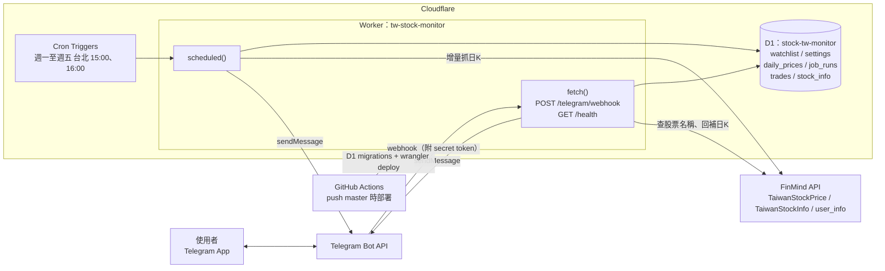
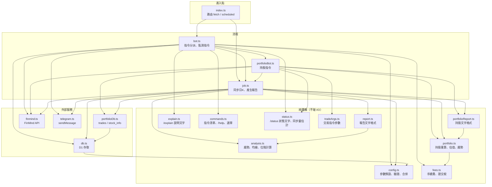
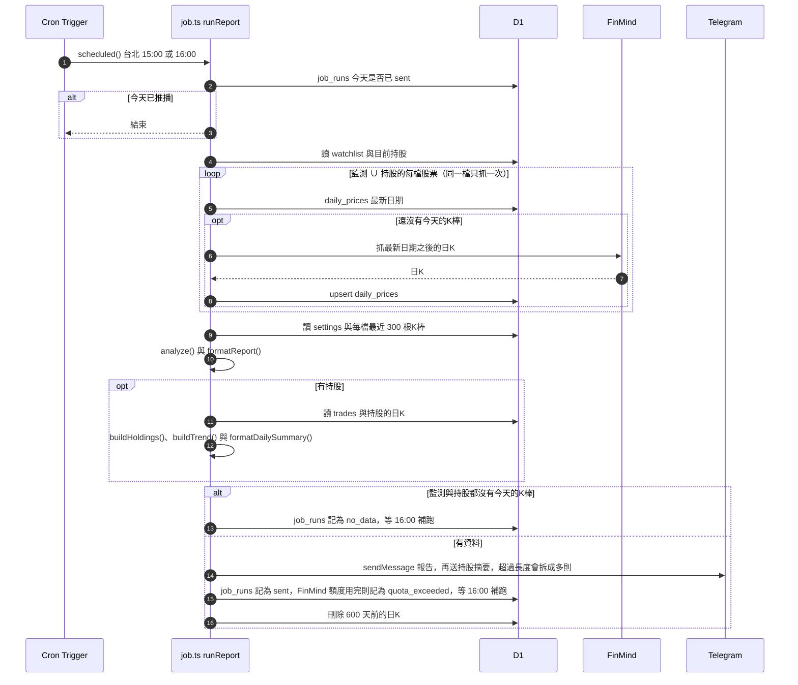
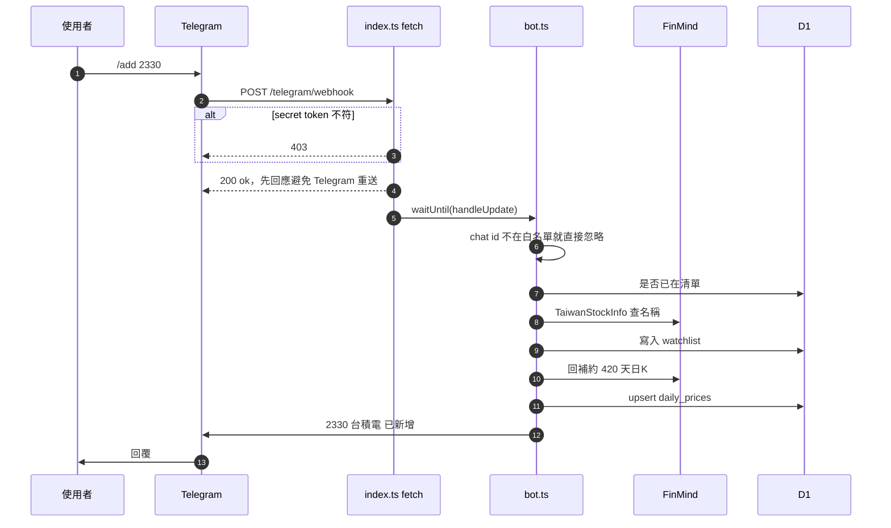
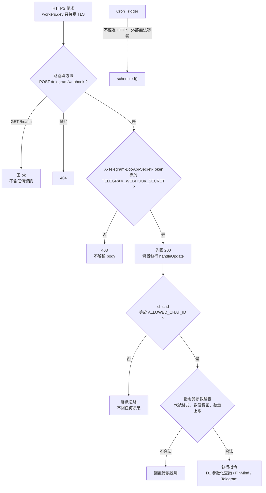
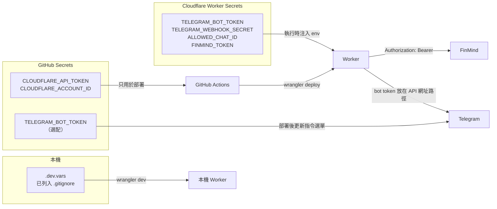
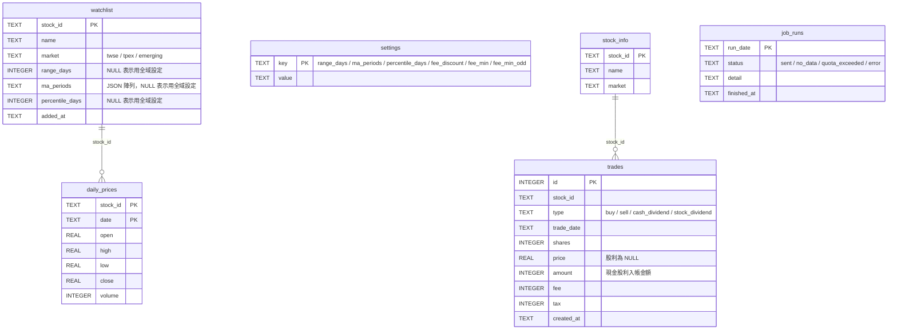

# 專案架構

這份文件用圖說明系統由哪些服務組成、程式模組怎麼分工、兩條主要流程（每日報告、Telegram 指令）怎麼跑，以及有哪些安全性防禦。
圖用 Mermaid 繪製，在 GitHub 上會直接顯示成圖。

## 系統架構

| 元件 | 角色 |
|---|---|
| Telegram Bot API | 收使用者指令（webhook 推給 Worker），送出回覆和報告 |
| Cron Triggers | 每個交易日 UTC 07:00、08:00（台北 15:00、16:00）觸發 `scheduled()` |
| Worker | 唯一的執行環境。`fetch()` 處理 webhook，`scheduled()` 產生每日報告 |
| D1 | 存監測清單、設定、日 K 快取、每日執行紀錄，以及持股的交易紀錄 |
| FinMind | 台股日 K 和股票基本資料的來源 |
| GitHub Actions | push 到 `master` 時跑型別檢查、測試、D1 migration，再部署 Worker |

## 程式模組

模組分成四層，箭頭只往下指：

- **進入點** `index.ts`：Worker 的 `fetch` 和 `scheduled` handler。webhook 會先驗證 `X-Telegram-Bot-Api-Secret-Token`，再交給 `bot.ts` 處理。
- **流程** `bot.ts`、`portfolioBot.ts`、`job.ts`：串接下面兩層。`bot.ts` 用指令名稱查表分派，持股指令交給 `portfolioBot.ts`。`/report` 重用 `job.ts` 的 `runReport`；`/add`、`/buy` 重用 `ensureHistory` 回補日 K。
- **純邏輯** `analysis.ts`、`report.ts`、`config.ts`、`explain.ts`、`commands.ts`、`status.ts`、`portfolio.ts`、`fees.ts`、`tradeArgs.ts`、`portfolioReport.ts`，以及共用的 `format.ts`（數字格式）、`message.ts`（依 Telegram 長度拆訊息）、`date.ts`（台北日期）：輸入資料、回傳結果，不呼叫任何外部服務，所以單元測試（`test/`）都集中在這一層。
- **外部服務** `db.ts`、`portfolioDb.ts`、`finmind.ts`、`telegram.ts`：各包一個外部服務，其他模組不直接下 SQL 或呼叫 HTTP API。`portfolioDb.ts` 只放持股用的資料表，手續費設定和其他全域設定一樣放在 `db.ts`。

`commands.ts` 是指令清單的唯一來源，`/help` 的文字和 Telegram 選單都從它產生。`scripts/set-commands.mjs` 會直接用 Node 載入它來呼叫 `setMyCommands`，所以它不 import 其他模組。

`types.ts` 放共用型別（`Env`、`Bar`、`StockConfig`、`WatchItem`、`Trade`），`format.ts`、`message.ts`、`date.ts` 也被很多模組引用，圖中省略。

## 每日報告流程

- 單一股票抓資料失敗不會中斷報告，會列在報告最後的「⚠️ 更新失敗」，該股票用資料庫裡既有的 K 棒分析。
- FinMind 回 402（每小時額度用完）時，剩下的股票不再呼叫 FinMind，一起列在「⚠️ 更新失敗」。當天記為 `quota_exceeded`，16:00 的 cron 會補抓並重發，所以那天可能收到兩份報告。
- 手動 `/report` 走同一個 `runReport`，但略過「今天已推播」和「沒有當天資料」兩個檢查，也不寫 `job_runs`。
- 監測清單是空的、但有持股時，只送持股摘要（以及更新失敗的股票）。
- 已出清的股票不再每天同步：它們的趨勢只需要出清前的日 K，已經存在 D1 裡。

### 持股計算

持股不存狀態。`portfolio.ts` 的 `replayTrades` 每次都把某檔股票的全部交易依（日期、編號）重新套用一次，得到股數、持有成本（移動加權平均，含買進手續費）、已實現損益和每筆賣出的損益。補登過去日期或刪除交易後，均價、損益和趨勢都會自動更正。

- 寫入或刪除交易前，`portfolioBot.ts` 先用「既有交易 + 新交易」或「刪除後的交易」重算一次，任何一天股數變負就拒絕。
- 每種交易類型（`buy`、`sell`、`cash_dividend`、`stock_dividend`）各有一個 reducer，新增類型（例如減資）只需要新增一個。
- 手續費和證交稅在記錄當下用 `fees.ts` 算好存進 `trades`，之後改費率不影響過去的交易；估值時的「預估賣出費用」用目前的費率。
- `buildTrend` 走過每個交易日，依序套用當天以前的交易，用當天（或之前最近一根）的收盤價估值。每日持股摘要的「今日損益」就是最後兩個點的總損益相減。
- 讀取日 K 和回補時，都從第一筆交易往前推 14 天開始，讓週末或連假買進的股票也拿得到前一個收盤價。

## Telegram 指令流程

以 `/add 2330` 為例：

`/report` 走上面的每日報告流程。`/status` 讀 D1 的 `job_runs`，並呼叫 FinMind `user_info` 查詢這一小時的請求用量（這個查詢不算額度）。`/buy`、`/sell` 遇到從沒出現過的股票時查 `TaiwanStockInfo`，之後回補日 K，流程和 `/add` 一樣。`/holdings`、`/pos`、`/trend` 和其他指令（`/list`、`/del`、`/set`、`/override`、`/div`、`/tradedel` 等）只讀寫 D1，不會呼叫 FinMind。`/explain`、`/help` 直接回傳固定文字。

## 安全性設計

這個 bot 只給一個人（或一個 chat）使用，主要要防的是：陌生人冒充 Telegram 呼叫 webhook、其他 Telegram 使用者對 bot 下指令、密鑰外洩，以及惡意或錯誤的輸入。

### 請求防禦層

每個打到 Worker 的 HTTP 請求都要依序通過下面幾關，任何一關沒過就停止處理：

| 威脅 | 防禦方式 | 位置 |
|---|---|---|
| 有人知道 Worker 網址，偽造 Telegram 的 webhook 請求 | 比對 Telegram 帶來的 `X-Telegram-Bot-Api-Secret-Token`，不符就回 403，連 body 都不解析 | `src/index.ts` |
| 其他 Telegram 使用者找到這個 bot 並下指令 | 只處理 `ALLOWED_CHAT_ID` 的訊息，其他 chat 一律不回應，不洩漏 bot 的存在與用途 | `src/bot.ts` `handleUpdate` |
| 外部觸發每日報告、洗版推播 | 報告只由 Cron Trigger 呼叫 `scheduled()`，沒有對外的 HTTP 入口；`job_runs` 確保一天只自動推播一次 | `src/index.ts`、`src/job.ts` |
| SQL injection | 所有 SQL 都用 `prepare().bind()` 參數化，使用者輸入不會拼進 SQL 字串 | `src/db.ts` |
| 惡意或錯誤的參數 | 股票代號必須符合 `^\d{4,6}[A-Z]?$`；`range`、`ma`、`pct` 有上下限；均線最多 8 條；交易的股數、價格、金額、日期、天數都有範圍檢查，不能記錄未來日期 | `src/config.ts`、`src/tradeArgs.ts`、`src/fees.ts` |
| 一次塞大量股票，耗盡對外請求額度 | `/add` 一次最多 10 檔 | `src/commands.ts` `MAX_ADD_PER_COMMAND` |
| Telegram 等太久而重送同一則訊息，造成指令重複執行 | 先回 200，再用 `waitUntil` 在背景處理 | `src/index.ts` |
| 錯誤訊息帶出大量外部回應內容 | FinMind、Telegram 的錯誤回應只保留前 200 字 | `src/finmind.ts`、`src/telegram.ts` |
| 回覆內容被當成格式語法解析 | `sendMessage` 不設 `parse_mode`，以純文字送出 | `src/telegram.ts` |
| bot 收到不需要的更新類型 | 設定 webhook 時 `allowed_updates` 只開 `message` | `scripts/set-webhook.sh` |

### 密鑰管理

| 密鑰 | 存放位置 | 用途 |
|---|---|---|
| `TELEGRAM_BOT_TOKEN` | Worker Secret | 呼叫 Telegram Bot API |
| `TELEGRAM_WEBHOOK_SECRET` | Worker Secret | 驗證 webhook 請求確實來自 Telegram，建議用 `openssl rand -hex 32` 產生 |
| `ALLOWED_CHAT_ID` | Worker Secret | 白名單 chat |
| `FINMIND_TOKEN` | Worker Secret | 以 `Authorization` header 送出，不放在網址裡，避免出現在記錄中 |
| `CLOUDFLARE_API_TOKEN` | GitHub Secret | CI 部署用，權限只開 Workers Scripts:Edit 和 D1:Edit |
| `TELEGRAM_BOT_TOKEN` | GitHub Secret（選配） | CI 部署後呼叫 `setMyCommands` 更新選單。只傳給這一個步驟，腳本出錯時也只印 Telegram 的錯誤說明，不印含 token 的網址 |

- 密鑰都不進版控：本機用 `.dev.vars`（已在 `.gitignore`），線上用 `wrangler secret put`，`.dev.vars.example` 只放假值。
- `wrangler.toml` 只寫 `database_name`，不寫 `database_id`：wrangler 部署和跑 migration 時會用名稱查到資料庫，所以同一份設定可以直接給別人部署到自己的帳號。即使 `database_id` 外流也不是密鑰，沒有 Cloudflare 帳號權限無法存取資料庫。

### 已知限制

以下是目前沒有防禦、但以個人使用的情境風險較低的地方。要加強時可以從這裡著手：

| 項目 | 說明 | 可行的加強方式 |
|---|---|---|
| secret token 用一般字串比對 | `!==` 比對在理論上有時序攻擊的可能，但網路延遲的雜訊遠大於比對時間差，實務上很難利用 | 改用 Workers 提供的 `crypto.subtle.timingSafeEqual` |
| webhook 沒有流量限制 | 帶錯誤 token 的請求會被 403 擋下，但每次仍算一次 Worker 呼叫，大量請求會消耗免費額度 | 在 Cloudflare 設定 WAF Rate Limiting 規則，或只允許 Telegram 的 IP 範圍 |
| 沒有用 `update_id` 去重 | 先回 200 已大幅降低重送機率，但 Worker 若在回應前失敗，Telegram 重送時指令會再執行一次。目前的指令大多可以重複執行（例如 `/add` 會先檢查是否已在清單） | 在 D1 記錄處理過的 `update_id` |
| 白名單是 chat 而不是使用者 | 如果 `ALLOWED_CHAT_ID` 設成群組，群組裡每個人都能操作 bot | 改成檢查 `message.from.id` |
| 錯誤訊息直接回給使用者 | 例外訊息（含外部服務回應的前 200 字）會送到 Telegram。只有白名單 chat 看得到，風險有限 | 回覆通用錯誤訊息，細節只寫入 Worker 記錄 |
| GitHub Actions 使用版本標籤 | `actions/checkout@v4` 這類標籤可以被上游改指向別的 commit | 改用完整 commit SHA 固定版本 |

## 資料表

- `settings` 存全域參數，`watchlist` 的三個覆寫欄位不是 NULL 時優先使用（`config.ts` 的 `resolveConfig`）。
- `daily_prices` 是 FinMind 日 K 的快取，讓每天只需要抓新增的資料。資料表之間沒有宣告外鍵，`/del` 時由程式一併刪除該股票的日 K。有交易紀錄的股票例外：`/del` 和每日刪除 600 天前日 K 時都會保留，因為持股的估值和趨勢要用到。
- `trades` 是持股唯一的資料來源，持股、均價和損益都從它重算。`stock_info` 存有交易紀錄的股票名稱，因為持股不一定在 `watchlist` 裡。
- `job_runs` 一天一筆，用來避免同一天重複推播。

Schema 定義在 `migrations/`，部署時由 GitHub Actions 自動套用。
